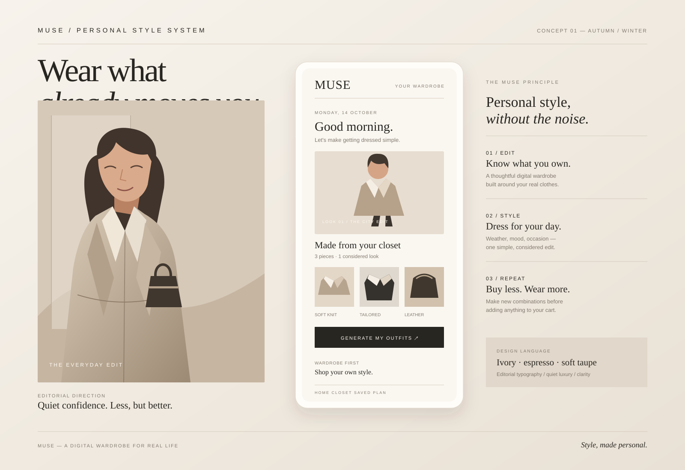

# MUSE — Personal AI Fashion Stylist

MUSE is a responsive wardrobe and outfit-planning prototype for everyday users, with a high-fashion editorial visual direction. It helps users plan outfits from pieces they already own, reduce decision fatigue, and avoid unnecessary impulse shopping.

## Live demo

[Open MUSE](https://olhakob.mamindurbeluk.workers.dev)

## Luxury editorial concept

The concept artwork explores MUSE as a quiet-luxury styling experience: warm ivory, espresso typography, soft taupe, editorial fashion imagery, a digital wardrobe, and wardrobe-first outfit recommendations. The image is an editable SVG asset at [`assets/muse-luxury-concept.svg`](assets/muse-luxury-concept.svg).

## Prototype features

- A stylized SVG digital-self illustration with interactive hair, skin, top, bottom, shoe, accessory, and full-look color controls.
- Outfit edit controls for occasion, mood, style direction, weather, and dress code.
- Outfit recommendations that respond to the selected weather, occasion, mood, and items in your uploaded wardrobe.
- Wardrobe-first suggestions that encourage reusing pieces you already own before shopping.
- Save/unsave looks and a saved-favourites counter.
- Wardrobe photo picker and drag-and-drop image intake with local previews, category labels, and an item counter.
- Local browser persistence for saved looks, preferences, and compressed wardrobe photos, so the digital closet can survive a refresh on the same device.
- Responsive desktop and mobile layout.
- Warm ivory, charcoal, and taupe luxury-editorial styling with refined serif typography and minimal controls.

## Run locally

No build step or dependencies are required. Open `index.html` in a modern browser, or serve the repository root with any static web server.

## Prototype limitations

This is a front-end demonstration, not a production AI or virtual try-on engine. Outfit suggestions are generated by front-end rules using your selected weather, occasion, mood, and wardrobe item names; they are not produced by a connected AI model. Browser storage is local to the current device/browser and is not synced to an account or cloud. The weather selector is a manual demo control rather than a live weather API. Wardrobe photos are compressed and stored in local browser storage, not uploaded to a backend. Avatar controls currently change the presentation style rather than editing a real 3D model.

## Suggested next steps

1. Deploy as a static site with Cloudflare Pages.
2. Add persistent wardrobe storage and image upload handling.
3. Connect live weather and a real recommendation service.
4. Replace the illustrative avatar with an interactive 3D model and garment fitting pipeline.
5. Add authentication, privacy controls, and saved looks synced across devices.
